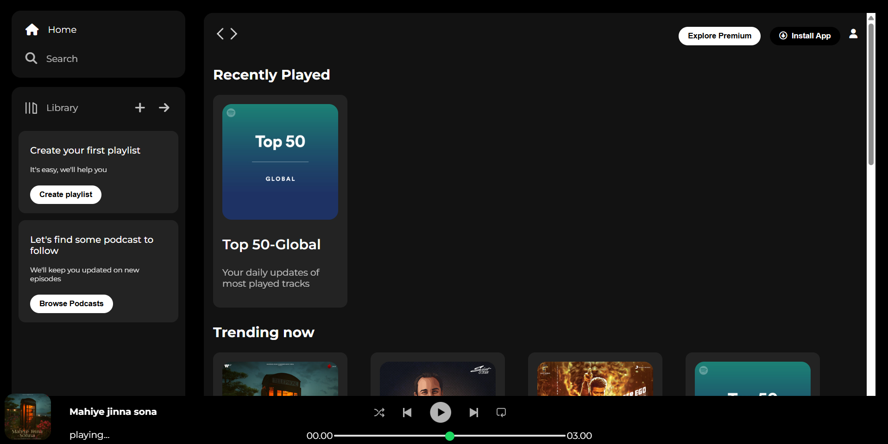
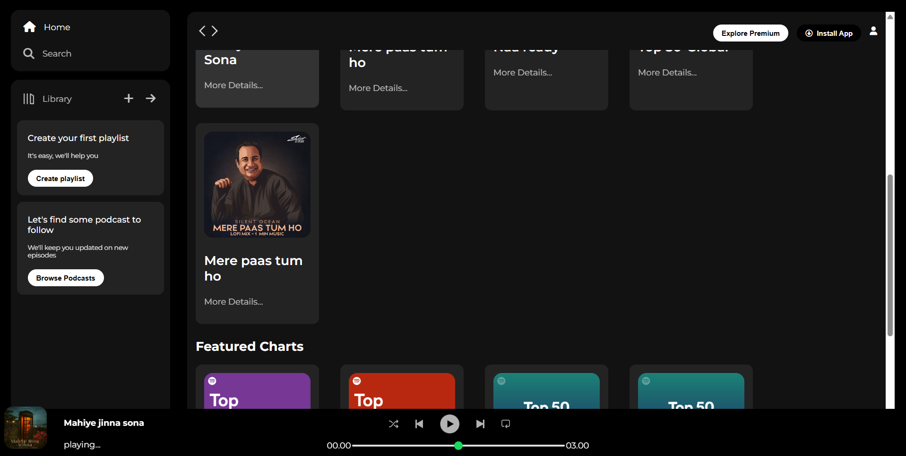

# Spotify Clone

A static, Spotify-inspired music player interface built with HTML and CSS. The page recreates the familiar desktop layout with a navigation sidebar, music-library prompts, browsing cards, and a persistent playback bar.

> This is a front-end design project for learning and demonstration. It does not connect to Spotify, stream music, or provide working navigation and playback controls.

## Preview





## Features

- Dark music-player layout with sidebar and scrollable main content
- Home and search navigation styling
- Library prompts for playlists and podcasts
- Recently played, trending, and featured chart cards
- Fixed bottom player bar with track information and a progress slider
- Hover states and a small-screen adjustment for selected navigation controls

## Built with

- HTML5
- CSS3
- [Font Awesome 6](https://fontawesome.com/) icons (loaded from a CDN)
- [Google Fonts: Montserrat](https://fonts.google.com/specimen/Montserrat)

## Run locally

No build step or package installation is required.

1. Download or clone this repository.
2. Open `index.html` in a browser, or use the VS Code Live Server extension.

## Project files

```text
Spotify Clone/
├── index.html       # Page structure and sample music content
├── style.css        # Layout, colors, and responsive styling
├── assets/          # Icons, album art, and player graphics
├── SS1.png          # Preview screenshot
└── SS2.png          # Preview screenshot
```

## Notes

- The artwork and track titles are sample content used to demonstrate the layout.
- The playback icons, progress slider, and navigation are visual elements only; no JavaScript behavior or audio is implemented.
- This project is not affiliated with or endorsed by Spotify.